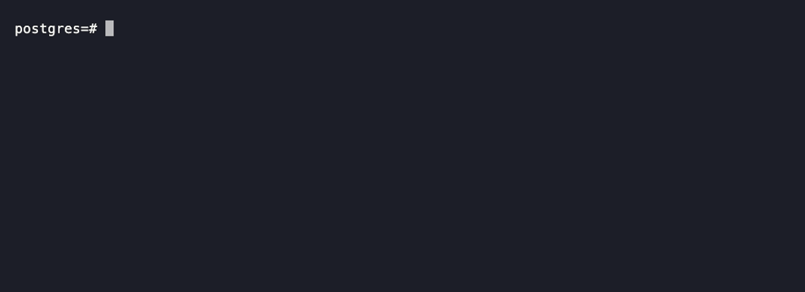

# pg_savior

pg_savior is a PostgreSQL extension that prevents accidental data loss and risky blocking schema changes. It inspects supported DML and DDL statements, raises an `ERROR` when a configured safety policy is violated, and aborts the transaction so the application notices.



> Background: [pg_savior — a seatbelt for Postgres](https://viggy28.dev/article/pg-savior-seatbelt-for-postgres/) explains why this exists and how it's designed.
>
> Regenerate the GIF with `vhs demo.tape` (see [demo.tape](./demo.tape)).

## Status

Pre-1.0: APIs, configuration, and policy defaults may change between releases. The regression suite validates both blocked and allowed statement shapes across PostgreSQL 14–17; review the documented statistics limitations and test your workload-specific policies before rollout.

## Features

- [x] Block `DELETE` without `WHERE`
- [x] Block `UPDATE` without `WHERE`
- [x] Row-count threshold guard (`pg_savior.max_rows_affected`)
- [x] Block unsafe `CREATE INDEX` operations, with partition-aware online workflows
- [x] Block rewrite-causing `ALTER TABLE ADD COLUMN` operations on large tables
- [x] Block heap-rewriting `ALTER TABLE ALTER COLUMN TYPE` operations on large tables
- [x] Block `TRUNCATE` on large tables
- [x] Block `DROP TABLE` on large tables
- [x] Block `DROP DATABASE`
- [x] Per-session bypass GUC (`pg_savior.bypass`)
- [x] Session-level on/off GUC (`pg_savior.enabled`)
- [ ] Per-table opt-out via reloptions
- [x] Volatility-aware `ADD COLUMN DEFAULT` detection

## Statement coverage

“Covered” means pg_savior inspects the statement and applies the policy described below; it does **not** mean every form is blocked. Safe forms, no-ops, operations below configured thresholds, and statements executed with bypass or protection disabled are allowed.

| Statement or family | Coverage | Current policy |
|---|---|---|
| `DELETE` | **Covered** | Blocks a statement without a `WHERE` clause. With `pg_savior.max_rows_affected > 0`, also blocks a qualified delete whose planner estimate exceeds the limit. Includes data-modifying CTEs. |
| `UPDATE` | **Covered** | Blocks a statement without a `WHERE` clause. With `pg_savior.max_rows_affected > 0`, also blocks a qualified update whose planner estimate exceeds the limit. Includes data-modifying CTEs. |
| `CREATE INDEX` / `CREATE UNIQUE INDEX` | **Covered** | Blocks non-concurrent builds. Allows `CONCURRENTLY`, harmless `IF NOT EXISTS` no-ops, and metadata-only `ON ONLY` indexes on partitioned parents. Partition leaf indexes must be built concurrently. |
| `ALTER TABLE ... ADD COLUMN` | **Partially covered** | On a large target, blocks volatile defaults and other additions known to rewrite existing rows, including constrained domains, serial/identity columns, and stored generated columns. Fast defaults and plain additions without rewrite work are allowed; column-level `UNIQUE`/`PRIMARY KEY` remains covered by the index-backed constraint policy. |
| `ALTER TABLE ... ADD CONSTRAINT` | **Partially covered** | On a large target, blocks newly built index-backed constraints and validated `CHECK`/foreign-key constraints. Allows attaching an existing unique index and adding `CHECK`/foreign-key constraints with `NOT VALID`; `PRIMARY KEY ... USING INDEX` remains guarded because it can scan for `NOT NULL`. |
| `ALTER TABLE ... ALTER COLUMN ... TYPE` | **Covered for heap rewrites** | Blocks conversions that PostgreSQL plans as heap rewrites when any affected physical inheritance or partition relation is large. Proven no-heap-rewrite conversions are allowed, although PostgreSQL may still rebuild dependent indexes or constraints. |
| `ALTER INDEX ... ATTACH PARTITION` | **Supported safe workflow** | Allowed so concurrently built leaf indexes can be attached to metadata-only partitioned parent indexes. |
| Other `ALTER TABLE` / `ALTER INDEX` subcommands | **Not covered** | No dedicated guard for operations such as `DROP COLUMN`, `SET NOT NULL`, `SET`/`DROP DEFAULT`, `SET TABLESPACE`, `SET ACCESS METHOD`, trigger changes, or most partition attach/detach operations. |
| `TRUNCATE` | **Partially covered** | Blocks explicitly named targets whose `reltuples` estimate exceeds the large-table threshold. Relations reached only through `CASCADE` are not independently checked. |
| `DROP TABLE` | **Partially covered** | Blocks explicitly named large tables. Objects removed only as dependencies of `CASCADE` are not independently checked. |
| `DROP DATABASE` | **Covered** | Always blocked while protection is enabled, regardless of size. |
| Other `DROP` statements | **Not covered** | No dedicated guard for `DROP SCHEMA`, `DROP OWNED`, `DROP INDEX`, `DROP VIEW`, `DROP MATERIALIZED VIEW`, `DROP SEQUENCE`, `DROP TYPE`, `DROP ROLE`, `DROP TABLESPACE`, or `DROP EXTENSION`. |
| `INSERT`, `COPY FROM`, `MERGE` | **Not covered** | Row creation and mixed-action `MERGE` statements are not inspected. |
| `CREATE TABLE AS`, `SELECT INTO` | **Not covered** | Statements that materialize query results into a new relation are not inspected. |
| `VACUUM FULL`, `CLUSTER`, `REINDEX`, `REFRESH MATERIALIZED VIEW` | **Not covered** | Rewrite- or lock-heavy maintenance commands have no dedicated guard. |
| `LOCK TABLE` | **Not covered** | Explicit lock acquisition is not inspected. |
| Read-only statements such as `SELECT` | **Not covered** | pg_savior does not apply a policy to read-only queries. |

Statements marked **Not covered** pass through to PostgreSQL unchanged; that label is not a safety assessment. Unless a statement is listed as covered above, do not assume pg_savior protects it. Size-sensitive policies use approximate `pg_class.reltuples` statistics, as described under [Configuration](#configuration).

## Installation

Build from source, or [download from PGXN](https://pgxn.org/extension/pg_savior).

```bash
make
sudo make install
```

### Activate the protection

`CREATE EXTENSION` alone does **not** activate pg_savior. The shared library must be loaded into Postgres backends. Pick one:

**Option 1 — Cluster-wide (recommended for production)**

Add to `postgresql.conf`:

```
shared_preload_libraries = 'pg_savior'
```

Then restart Postgres. Every backend forked from the postmaster will have the hook installed automatically.

**Option 2 — Per-session, no restart**

Add to `postgresql.conf`:

```
session_preload_libraries = 'pg_savior'
```

Then `SELECT pg_reload_conf();`. Every new connection from then on installs the hook.

**Option 3 — Per-session, manual (development)**

```sql
LOAD 'pg_savior';
```

Once loaded by any of the above, register the extension in each database:

```sql
CREATE EXTENSION pg_savior;
```

## Usage

```
postgres=# CREATE EXTENSION pg_savior;
CREATE EXTENSION

postgres=# CREATE TABLE emp (id int);
CREATE TABLE

postgres=# INSERT INTO emp VALUES (1), (2), (3);
INSERT 0 3

postgres=# DELETE FROM emp;
ERROR:  pg_savior: DELETE without WHERE clause is blocked
HINT:  Add a WHERE clause, or set pg_savior.bypass = on for this session.

postgres=# SELECT count(*) FROM emp;
 count
-------
     3
(1 row)

postgres=# DELETE FROM emp WHERE id = 1;
DELETE 1
```

## Configuration

| GUC | Default | Scope | Effect |
|---|---|---|---|
| `pg_savior.enabled` | `on` | session (`USERSET`) | Master switch. When `off`, no checks run. |
| `pg_savior.bypass` | `off` | session (`USERSET`) | When `on`, all pg_savior guards are bypassed for the current session. Use for an intentional operation that would otherwise be blocked. |
| `pg_savior.max_rows_affected` | `0` (disabled) | session (`USERSET`) | When > 0, refuse `DELETE`/`UPDATE` whose planner row estimate exceeds this. Catches destructive queries that *do* have a `WHERE` but match too much (e.g. `DELETE FROM emp WHERE id > 0`). |
| `pg_savior.large_table_threshold_rows` | `1000000` | session (`USERSET`) | Tables with `pg_class.reltuples` greater than this are considered "large" for size-sensitive DDL guards. Raise it for permissive environments, lower it for stricter ones. |

Example bypass for an intentional cleanup:

```sql
BEGIN;
SET LOCAL pg_savior.bypass = on;
DELETE FROM staging_table;
COMMIT;
```

Example row-count guard for a destructive query that has a WHERE but matches too much:

```sql
postgres=# SET pg_savior.max_rows_affected = 100;
SET
postgres=# DELETE FROM emp WHERE id > 0;
ERROR:  pg_savior: DELETE estimated to affect 1000 rows, exceeds pg_savior.max_rows_affected (100)
HINT:  Refine the WHERE clause, raise pg_savior.max_rows_affected, or set pg_savior.bypass = on. Run ANALYZE if the estimate looks wrong.
```

The threshold uses the planner's row estimate, which remains approximate even with fresh statistics and can be inaccurate when statistics are missing or stale. Run `ANALYZE` after major data changes, choose a conservative threshold, and treat this guard as a seatbelt rather than an exact affected-row guarantee. The estimate guard also walks data-modifying CTEs, so wrapping an `UPDATE` or `DELETE` in `WITH` does not bypass the threshold.

Example DDL guards:

```
postgres=# CREATE INDEX emp_idx ON emp (id);
ERROR:  pg_savior: CREATE INDEX without CONCURRENTLY is blocked
HINT:  Use CREATE INDEX CONCURRENTLY (it cannot run in a transaction block), or set pg_savior.bypass = on for this session.

postgres=# ALTER TABLE big_emp ADD COLUMN sample double precision DEFAULT random();
ERROR:  pg_savior: ALTER TABLE ADD COLUMN with volatile DEFAULT on a large table (5000000 rows) is blocked
HINT:  This operation can rewrite or scan the whole table while holding a strong lock. Plan a safer migration; raise pg_savior.large_table_threshold_rows; or set pg_savior.bypass = on. Run ANALYZE if the row estimate looks wrong.

postgres=# DROP TABLE big_emp;
ERROR:  pg_savior: DROP TABLE on a large table "big_emp" (5000000 rows) is blocked
HINT:  Verify the target, raise pg_savior.large_table_threshold_rows, or set pg_savior.bypass = on. Run ANALYZE if the row estimate looks wrong.

postgres=# DROP DATABASE production_db;
ERROR:  pg_savior: DROP DATABASE "production_db" is blocked
HINT:  Set pg_savior.bypass = on for this session if you really mean it.

postgres=# TRUNCATE big_emp;
ERROR:  pg_savior: TRUNCATE on a large table "big_emp" (5000000 rows) is blocked
HINT:  Verify the target, raise pg_savior.large_table_threshold_rows, or set pg_savior.bypass = on. Run ANALYZE if the row estimate looks wrong.

postgres=# ALTER TABLE big_emp ALTER COLUMN id TYPE bigint;
ERROR:  pg_savior: ALTER TABLE ALTER COLUMN TYPE on a large table (5000000 rows) is blocked
HINT:  This operation can rewrite or scan the whole table while holding a strong lock. Plan a safer migration; raise pg_savior.large_table_threshold_rows; or set pg_savior.bypass = on. Run ANALYZE if the row estimate looks wrong.
```

PostgreSQL does not support `CREATE INDEX CONCURRENTLY` directly on a partitioned parent. pg_savior blocks a recursive parent build, but allows PostgreSQL's metadata-only `ON ONLY` workflow:

```sql
CREATE INDEX events_created_idx ON ONLY events (created_at);
CREATE INDEX CONCURRENTLY events_2025_created_idx
  ON events_2025 (created_at);
ALTER INDEX events_created_idx
  ATTACH PARTITION events_2025_created_idx;
```

Repeat the concurrent build and attachment for every leaf partition. For a multi-level partition tree, create an `ON ONLY` index on each intermediate partitioned table, attach its leaf indexes first, and then attach that completed index to its parent. PostgreSQL marks the parent index valid after all child indexes are attached.

`CREATE INDEX ON ONLY` remains blocked for ordinary tables because it still builds the index there. Recursive parent builds and non-concurrent leaf builds also remain blocked. The CREATE INDEX policy is intentionally independent of `pg_savior.large_table_threshold_rows`: lock safety depends on the build method, and even an empty partition tree can later acquire populated partitions. Session bypass and disabled mode retain their normal precedence.

The ALTER COLUMN TYPE guard follows PostgreSQL 14–17's heap-rewrite decision rather than maintaining a list of type pairs. pg_savior transforms a private copy of an explicit `USING` expression against the original relation, applies PostgreSQL's assignment coercion and collation processing, plans the expression, and then uses the same allowed shapes as core: the original column `Var`, optionally wrapped in binary-compatible `RelabelType` nodes, unconstrained `CoerceToDomain` nodes, or timestamp/timestamptz conversion functions when the session time zone is UTC-safe. Type-specific typmod changes that PostgreSQL plans without a rewrite (for example, widening `varchar`) and binary-compatible changes therefore pass; rewrite-causing typmod changes, integer widening, constrained domains, arbitrary `USING` calculations, and timestamp/timestamptz changes in a time zone where core requires conversion are blocked on large physical tables. An explicit identity `USING column_name` is allowed when its planned expression has one of the no-rewrite shapes.

For recursive ALTERs, each physical inheritance child and partition is checked while the root is held at the ALTER's lock level; descendant inspection uses short-lived share locks so PostgreSQL's identity-sequence lock order is preserved. A small or storage-less parent cannot hide a large descendant. `ALTER TABLE ONLY` does not inspect descendants, and storage-less partitioned parents do not contribute a row estimate themselves.

“No heap rewrite” only describes the table heap. PostgreSQL can still rebuild or revalidate dependent indexes and constraints while changing catalog types, so an allowed ALTER may still perform significant auxiliary work and hold an `ACCESS EXCLUSIVE` lock. pg_savior leaves PostgreSQL's dependency checks and errors in force.

The ADD COLUMN guard follows PostgreSQL's fast-default rules. Immutable constants and expressions, plus `STABLE` functions such as `now()`, are evaluated once and stored as a missing value without rewriting existing rows, so pg_savior allows them. `VOLATILE` expressions such as `random()`, `nextval()`, and volatile user-defined functions require per-row evaluation and are blocked on large tables. Defaults and implicit values that require rewrites—constrained domains, serial/identity columns, and stored generated columns—are blocked as well.

Volatility comes from PostgreSQL's function catalog metadata. User-defined functions must be labeled correctly (`IMMUTABLE`, `STABLE`, or `VOLATILE`) for PostgreSQL and pg_savior to classify them correctly.

The volatility check covers explicit column defaults. An implicit default supplied only by an unconstrained domain is left to PostgreSQL because its backfill behavior differs across supported server minors; use an explicit column default when you want pg_savior to classify that expression.

Size-sensitive DDL guards use `pg_class.reltuples`, which is intentionally approximate. A never-analyzed table has unknown statistics, and statistics can be stale after bulk changes. This can produce both false negatives (a large table with missing or stale-low statistics) and false positives (an empty table with stale-high statistics). Run `ANALYZE` before relying on a row threshold; pg_savior does not perform an expensive exact row count while processing DDL.

## Tests

The extension uses `pg_regress` (the standard PGXS test framework). Run against a local cluster:

```bash
make installcheck
```

Each test file uses `LOAD 'pg_savior'` so the framework works whether or not `pg_savior` is in `shared_preload_libraries`.

The safety-matrix suites pair dangerous and safe forms and verify database state after every rejection:

- `alter_type_rewrite` — planned ALTER TYPE shapes, heap filenodes, inheritance/partitions, dependencies, thresholds, and controls
- `safety_dml_shapes` — CTEs, subqueries, prepared statements, parameters, `RETURNING`, and estimate thresholds
- `safety_relation_types` — views, partitioned tables, and inherited tables
- `safety_ddl_edges` — multi-target DDL, index no-ops, generated indexes, constraints, and threshold boundaries
- `safety_statistics` — deterministic characterization of missing and stale statistics
- `partitioned_index` — recursive parent rejection, concurrent leaf builds, `ON ONLY`, multi-level attachment, thresholds, and overrides

Literal tautologies such as `WHERE true` count as an explicit `WHERE` clause by design. Enable `pg_savior.max_rows_affected` when protection must be based on estimated impact rather than statement syntax.

### Docker-based integration test

A self-contained integration test that builds Postgres + pg_savior in a container and runs the suite end-to-end:

```bash
./docker/test.sh
```

Test against a different Postgres major version:

```bash
PG_MAJOR=15 ./docker/test.sh
```

### Continuous integration

Pull requests and pushes to `main` run the complete `pg_regress` suite in the following jobs. Each job maps directly to the same Docker entry point used locally:

| CI job | Local command |
|---|---|
| `PostgreSQL 14` | `PG_MAJOR=14 ./docker/test.sh` |
| `PostgreSQL 15` | `PG_MAJOR=15 ./docker/test.sh` |
| `PostgreSQL 16` | `PG_MAJOR=16 ./docker/test.sh` |
| `PostgreSQL 17` | `PG_MAJOR=17 ./docker/test.sh` |

The stable `CI` job is the aggregate branch-protection status; it succeeds only when every version-specific job succeeds and has no additional local test command. Failed version jobs upload the regression diff, actual results, and PostgreSQL container logs when available. To save the same diagnostics locally, set `TEST_ARTIFACT_DIR`, for example:

```bash
TEST_ARTIFACT_DIR=artifacts PG_MAJOR=17 ./docker/test.sh
```

`PG_MAJOR` selects the official `postgres:<major>` base image. Pinning the major this way tests each supported server API while still receiving the latest minor and security updates published for that major. To add PostgreSQL 18 or a later supported major, add its quoted major number to `matrix.pg` in [`.github/workflows/ci.yml`](.github/workflows/ci.yml); no new job definition or test script is needed.

If you change a test's SQL, regenerate its expected output:

```bash
# clear stale expected file, leave an empty placeholder so pg_regress
# runs the test instead of bailing out, then capture
> expected/<testname>.out
./docker/test.sh --capture-expected
```

## How it works

pg_savior installs three hooks:

1. **`post_parse_analyze_hook`** — fires after parse-analyze, before planning. Inspects the top-level `Query` and data-modifying CTEs: if a `DELETE`/`UPDATE` has no `WHERE`, it raises `ERROR`. Independent of plan shape; parameterized statements handled correctly; no planner work wasted on a query that will be refused.

2. **`ExecutorStart_hook`** — fires after planning, before execution. If `pg_savior.max_rows_affected > 0`, checks each `ModifyTable` source estimate, including data-modifying CTE subplans, and raises `ERROR` above the threshold. The transaction aborts before any tuples are touched.

3. **`ProcessUtility_hook`** — fires for utility statements (DDL). Refuses:
   - `CREATE INDEX` without `CONCURRENTLY` (except an `IF NOT EXISTS` no-op and metadata-only `ON ONLY` indexes on partitioned tables); recursive partitioned-parent builds remain blocked, while concurrent leaf builds and `ALTER INDEX ... ATTACH PARTITION` are allowed
   - `ALTER TABLE ADD COLUMN` when the default is volatile or the new column otherwise requires a per-row rewrite (constrained domain, serial/identity, or stored generated column) and the target table is over the threshold
   - `ALTER TABLE ADD` a newly built index-backed constraint, including column-level `UNIQUE`/`PRIMARY KEY`, when the target table is over the threshold; attaching an existing unique index is allowed, while `PRIMARY KEY ... USING INDEX` remains guarded because it may scan to enforce `NOT NULL`
   - `ALTER TABLE ADD` a validated `CHECK`/foreign-key constraint when the target table is over the threshold (`NOT VALID` is allowed)
   - `ALTER TABLE ALTER COLUMN TYPE` when PostgreSQL's planned conversion expression requires a heap rewrite and any affected physical inheritance/partition relation is over the threshold; binary-compatible changes, widening typmods, unconstrained domains, identity `USING`, and UTC-safe timestamp/timestamptz conversions are allowed when core does not rewrite
   - `TRUNCATE` when any target table is over the threshold (multi-table truncates blocked if *any* target is large)
   - `DROP TABLE` when any target table is over the threshold (multi-table drops blocked if *any* target is large)
   - `DROP DATABASE` (always)

   "Over the threshold" means `pg_class.reltuples > pg_savior.large_table_threshold_rows`.

All checks honour `pg_savior.enabled` and `pg_savior.bypass`.
